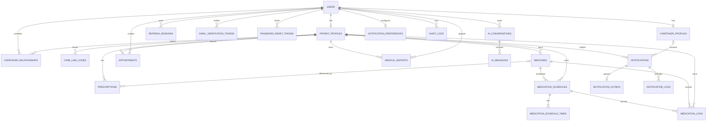

# MediBridge Entity Relationship Diagram

`o|--o{` on prescription/notification relationships represents an optional reference from each child row. Authorization is enforced in application services in addition to the relational constraints.
